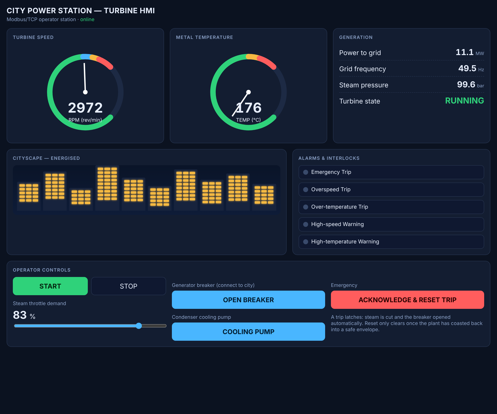
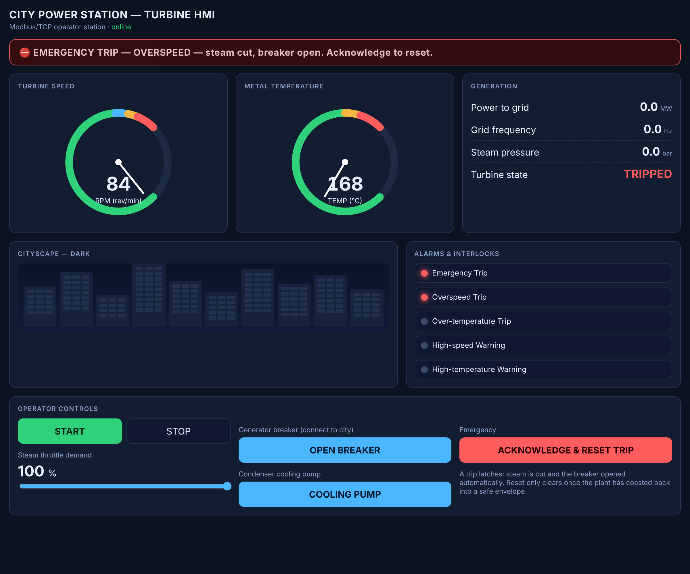

# ICS Power-Plant Turbine Simulator (Modbus TCP)

An educational **industrial control system (ICS)** simulation of a steam-turbine
power station. A PLC runs the turbine physics and exposes a **Modbus/TCP**
register map; an **HMI** (web dashboard *and* terminal client) drives the
turbine and visualises the plant. When the operator brings the turbine up to
speed and closes the generator breaker, the **cityscape lights up**. Two
hard-wired **safety interlocks** — overspeed and over-temperature — trip the
plant automatically.

This mirrors a real ICS architecture: the only contract between the controller
and the operator stations is the Modbus register map. The HMI holds no process
state of its own.

| Normal generation — city energised | Emergency overspeed trip |
|---|---|
|  |  |

---

## Architecture

```
 ┌───────────────────────┐        Modbus/TCP         ┌──────────────────────────┐
 │   HMI  (Modbus client) │  ───── read IR / DI ────► │  PLC  (Modbus TCP server)│
 │                        │  ◄──── write HR ────────  │                          │
 │ • hmi_web.py  (browser)│                           │ • turbine physics @ 10 Hz│
 │ • hmi_cli.py  (console)│                           │ • safety interlocks      │
 └───────────────────────┘                           │ • register image         │
        ▲  browser                                    └──────────────────────────┘
        │  HTTP + JSON
   operator
```

* **`plc_server.py`** — the turbine controller. A Modbus TCP server that owns
  the process image and runs a 10 Hz scan: read operator commands from holding
  registers → advance the turbine model → publish telemetry to input registers
  and alarm/trip bits to discrete inputs.
* **`turbine_model.py`** — the plant physics and safety logic, fully decoupled
  from Modbus so it can be unit-tested deterministically.
* **`hmi_web.py`** — a browser SCADA screen served over HTTP; a thin JSON API
  bridges the browser to a Modbus client.
* **`hmi_cli.py`** — a terminal HMI (live monitor + one-shot command tool).
* **`registers.py`** — the shared register map (the wire contract).
* **`test_safety.py`** — automated tests proving the safety interlocks fire.

---

## Quickstart

```bash
pip install -r requirements.txt

# 1) Start the PLC (turbine controller + Modbus TCP server on port 5020)
python -m powerplant.plc_server

# 2a) Open the web HMI  ->  http://127.0.0.1:8080
python -m powerplant.hmi_web

# 2b) ...or drive it from the terminal
python -m powerplant.hmi_cli monitor
```

### Bring the plant online (from the HMI)

1. **START** (admit steam / master run).
2. Raise the **steam throttle** to ~**83 %** — the rotor spins up past the
   synchronous speed band (~2950–3000 rpm).
3. **CLOSE BREAKER** — the generator synchronises to the grid and the
   **cityscape energises**. Power (MW) and grid frequency (Hz) come alive.

Then try breaking it: push the throttle to **100 %** (→ overspeed trip), or turn
the **cooling pump off** and hold a high load (→ over-temperature trip). The
plant trips itself, sheds load, and the city goes dark.

---

## Safety interlocks

Both interlocks are enforced **inside the PLC**, independent of the HMI — an
operator cannot override them from the panel.

| Interlock | Threshold | Action |
|---|---|---|
| **Overspeed trip** | shaft speed ≥ **3300 rpm** | latched trip |
| **Over-temperature trip** | metal temp ≥ **540 °C** | latched trip |
| High-speed warning | ≥ 3150 rpm | amber pre-trip alarm |
| High-temperature warning | ≥ 500 °C | amber pre-trip alarm |

A **trip is latched**: it slams the steam valve shut, opens the generator
breaker, and de-energises the city. It will **not** clear just because the
setpoint is lowered — the operator must press **Acknowledge & Reset**, *and* the
plant must have coasted back into a safe envelope (speed < 1000 rpm and
temperature < 450 °C). This models a real emergency trip system (ETS).

Run the safety tests:

```bash
python -m powerplant.test_safety     # or: pytest powerplant/test_safety.py
```

```
  normal:   rpm=2985  temp=321C  power=17.6MW  freq=49.7Hz  city=ON
  overspeed: tripped at ~3300 rpm, latched
  overtemp:  tripped at ~540C (rpm below overspeed)
  reset:     refused while hot/fast, accepted after coast-down
  All 4 safety tests passed.
```

---

## Modbus register map

Modbus registers are unsigned 16-bit words. Analogue values that need a fraction
are scaled ×10 on the wire (e.g. temperature `1843` ⇒ `184.3 °C`). Default unit
id `1`, port `5020`.

### Holding registers — operator commands & setpoints (FC 03 / 06), read/write

| Addr | Name | Range | Meaning |
|---|---|---|---|
| 0 | `MASTER_RUN` | 0/1 | stop / run (admit steam) |
| 1 | `THROTTLE` | 0–100 | steam admission valve demand (%) |
| 2 | `BREAKER_CLOSE` | 0/1 | open / close generator breaker to the city |
| 3 | `RESET_TRIP` | 0/1 | write 1 to acknowledge & clear a latched trip |
| 4 | `COOLING_PUMP` | 0/1 | condenser cooling pump off / on |

### Input registers — measured telemetry (FC 04), read-only

| Addr | Name | Scale | Units |
|---|---|---|---|
| 0 | `RPM` | ×1 | rev/min |
| 1 | `TEMP` | ×10 | °C |
| 2 | `POWER` | ×10 | MW |
| 3 | `CITY_SUPPLIED` | — | 0/1 |
| 4 | `BREAKER_STATE` | — | 0/1 |
| 5 | `TURBINE_STATE` | — | 0=stopped, 1=running, 2=tripped |
| 6 | `GRID_FREQ` | ×10 | Hz |
| 7 | `STEAM_PRESSURE` | ×10 | bar |

### Discrete inputs — alarms & trips (FC 02), read-only

| Addr | Name |
|---|---|
| 0 | `TRIP_ACTIVE` |
| 1 | `ALARM_OVERSPEED` |
| 2 | `ALARM_OVERTEMP` |
| 3 | `WARN_HIGH_RPM` |
| 4 | `WARN_HIGH_TEMP` |

---

## Terminal HMI

```bash
python -m powerplant.hmi_cli monitor            # live dashboard
python -m powerplant.hmi_cli cmd master_run 1   # one-shot command
python -m powerplant.hmi_cli cmd throttle 83
python -m powerplant.hmi_cli cmd breaker_close 1
python -m powerplant.hmi_cli cmd reset_trip 1
```

```
  CITY POWER STATION — TURBINE (Modbus/TCP)
  ----------------------------------------------------
  State    RUNNING     Breaker CLOSED  City on
  RPM       2981  ███████████████████████·····
  Temp °C    201  █████████···················
  Power MW  15.7   Freq 49.7 Hz   Steam  99.6 bar
  ----------------------------------------------------
  Alarms   all clear
```

---

## Notes & scope

* Ships `pymodbus 3.6.9` (stable classic datastore API).
* The turbine model is a readable lumped approximation tuned for real-time
  response and clear demonstrations — not a plant-grade thermodynamic model.
* Modbus has **no authentication or encryption** (by design, historically).
  This project binds to `127.0.0.1` for safe local use. The lack of
  authentication in fieldbus protocols like Modbus is itself a core ICS-security
  teaching point.
* **For education and lab use only.**
